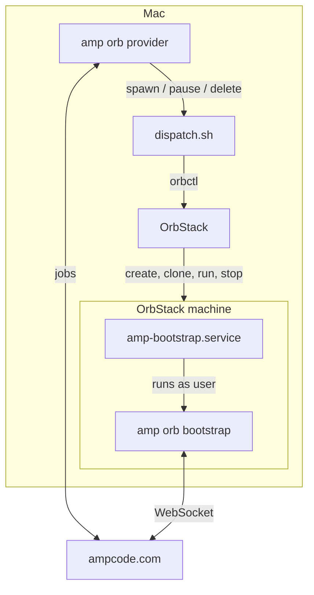

# OrbStack Orb Provider for Amp Code

Run [Amp](https://ampcode.com) orbs on your Mac with [OrbStack](https://orbstack.dev). Each Amp thread gets a dedicated Linux machine. You control the compute and the network, and there's no cloud bill.

**Features**

- **One machine per thread.** Each machine is created on the first message and deleted when the thread is deleted.
- **Persistent workspace.** Files, dependencies, and databases survive pause and resume.
- **Stopped when idle.** Machines stop when a thread goes idle and start on the next message.
- **Setup caching.** Amp project snapshots are stored as copy-on-write clones, so new threads skip `.agents/setup`.
- **Isolated by default.** Orbs can't see your Mac's files, other machines, or host ports.
- **No inbound access.** The provider and orbs connect out to Amp. No ports, ingress, or DNS are needed.

**Contents**

- [Getting started](#getting-started)
- [Preparing your repository](#preparing-your-repository)
- [Running as a service](#running-as-a-service)
- [Lifecycle](#lifecycle)
- [Configuration reference](#configuration-reference)
- [Troubleshooting](#troubleshooting)
- [Limitations](#limitations)
- [Architecture](#architecture)
- [Development](#development)

## Getting started

### Prerequisites

- An Amp workspace with self-hosted orbs enabled. A workspace admin can turn this on in the Orbs settings.
- A Mac with [OrbStack](https://orbstack.dev) installed and running, plus `amp` and `jq`.

### 1. Register the provider in Amp

In your Amp workspace settings, open **Custom Orb Providers** and create a provider. Copy the `aop_live_…` token. Amp shows it only once.

### 2. Start the provider

```sh
export AMP_ORB_PROVIDER_TOKEN=aop_live_...
amp orb provider "$PWD/dispatch.sh"
```

The provider holds an outbound connection to Amp and waits for jobs.

### 3. Create your first orb

In Amp, start a new thread, expand **Orb**, and select your provider under **Self-Hosted**. The first spawn takes about 90 seconds, plus your repository's setup time. The very first spawn on a Mac also downloads the distro image. Follow progress in the thread's setup log.

### 4. Verify (optional)

```sh
./smoke-test.sh
```

This runs a full spawn, pause, resume, snapshot, and delete cycle against throwaway machines, then removes them.

## Preparing your repository

Amp runs your repository's `.agents/setup` script on each new orb, unless the orb starts from a project snapshot.

**Make setup complete.** The script should leave the app ready to run, not just install dependencies. For example, after installing packages, it should also create the database, run migrations, and generate any required config or keys.

**Make setup idempotent.** It may run more than once on the same disk. Check before installing system packages, and use non-interactive flags.

**Listen on `$PORT`.** Amp assigns each dev server a port and routes its portal there. A server bound to a fixed port causes the portal to report *"nothing is listening on port N."* Have your dev command read the port from `$PORT`, falling back to your usual default. For example, with Vite:

```sh
vite --port ${PORT:-5173} --strictPort
```

**Install extra runtimes with apt.** Node (Ubuntu's package), npm, git, gh, tmux, and ripgrep are preinstalled. Install anything else with `sudo apt-get install` in `.agents/setup`. The orb user has passwordless sudo.

## Running as a service

Amp expects the provider to restart after a reboot. OrbStack runs per user, so run the provider as a launchd agent for the same user.

`~/Library/LaunchAgents/com.ampcode.orb-provider.plist`:

```xml
<?xml version="1.0" encoding="UTF-8"?>
<!DOCTYPE plist PUBLIC "-//Apple//DTD PLIST 1.0//EN" "http://www.apple.com/DTDs/PropertyList-1.0.dtd">
<plist version="1.0"><dict>
  <key>Label</key><string>com.ampcode.orb-provider</string>
  <key>ProgramArguments</key><array>
    <string>/Users/you/.local/bin/amp</string><string>orb</string><string>provider</string>
    <string>/path/to/orbstack-orb-provider/dispatch.sh</string>
  </array>
  <key>EnvironmentVariables</key><dict>
    <key>AMP_ORB_PROVIDER_TOKEN</key><string>aop_live_...</string>
    <key>PATH</key><string>/Users/you/.local/bin:/opt/homebrew/bin:/usr/local/bin:/usr/bin:/bin</string>
  </dict>
  <key>RunAtLoad</key><true/>
  <key>KeepAlive</key><true/>
</dict></plist>
```

launchd doesn't expand variables, so use absolute paths throughout. Load it with `launchctl load ~/Library/LaunchAgents/com.ampcode.orb-provider.plist`.

The provider reads `dispatch.sh` fresh for every job, so changes take effect without a restart. Existing machines pick up service unit changes on their next spawn.

## Lifecycle

| Amp event | Provider action | Machine state |
|---|---|---|
| Thread created | Create (or clone from snapshot), provision, start bootstrap | Running |
| Thread idle or archived | Stop bootstrap, remove token, stop machine | Stopped |
| Pause with snapshot | Also clone the stopped machine to `amp-snap-<id>` | Stopped |
| Next message | Start machine, restart bootstrap with a fresh token | Running |
| Thread deleted | Delete the machine | Gone |

What persists across pause:

- **Kept:** files, installed packages, databases, git state.
- **Lost:** running processes. Dev servers restart when the thread resumes.

**Disk usage.** Clones are copy-on-write, so snapshots cost only what changes after them. `amp projects snapshots delete` doesn't remove `amp-snap-*` machines. Delete stale ones with `orb delete -f amp-snap-<id>`.

## Configuration reference

### Environment variables

Set on the provider host:

| Variable | Required | Description |
|---|---|---|
| `AMP_ORB_PROVIDER_TOKEN` | Yes | Provider token from Amp workspace settings |
| `ORBSTACK_DISTRO` | No | Distro for new orbs. Default `ubuntu:26.04`. Must be glibc-based; Alpine doesn't work |
| `ORBSTACK_CREATE_ARGS` | No | Flags for `orbctl create`. Default `--isolated --isolate-network`. Add `--cpus`, `--memory`, `--disk`, or `-a amd64` here |
| `ORBCTL_BIN` | No | Path to `orbctl`, if it isn't on `PATH` |

Set by Amp for each job:

| Variable | Description |
|---|---|
| `ORB_OPERATION` | `spawn`, `pause`, or `delete` |
| `ORB_ID` | Orb identifier. Used as the machine name |
| `ORB_SNAPSHOT_ID` | Snapshot to save on pause or boot from on spawn. Stored as machine `amp-snap-<id>` |
| `ORB_TOKEN`, `AMP_URL` | Credentials for the orb's connection to Amp (spawn only) |
| `ORB_IMAGE` | Not used. See [Limitations](#limitations) |

### What's installed on each machine

| Item | Purpose |
|---|---|
| `user` account | Runs Amp and your code. Home is `/home/user`, with passwordless sudo |
| `amp` CLI | Installed in `/home/user/.amp`, linked at `/usr/local/bin/amp` |
| git, curl, node, npm, tmux, ripgrep, gh | Required or recommended by Amp's orb contract |
| `amp-bootstrap.service` | systemd unit that runs `amp orb bootstrap` as `user` |
| `/etc/amp-orb/env` | `ORB_TOKEN` and `AMP_URL`, mode `0600`. Removed on pause |

## Troubleshooting

`<name>` is the thread's orb ID, such as `amp-01a16eb1-…`. Find it with `orb list`.

```sh
orb run -m <name> -u root systemctl status amp-bootstrap        # bootstrap state
orb run -m <name> -u root journalctl -u amp-bootstrap -n 50     # bootstrap log
orb run -m <name> -u user tail -50 /home/user/.cache/amp/logs/cli.log   # Amp log
```

| Symptom | Likely cause | Fix |
|---|---|---|
| Thread never gets an orb | The provider is offline, or OrbStack isn't running | Check the provider's output, and run `orb status` |
| Setup script fails | An error in your repository's `.agents/setup` | Read the setup log in the thread. See [Preparing your repository](#preparing-your-repository) |
| Portal: "nothing is listening on port N" | Your dev server ignores `$PORT` | See [Listen on `$PORT`](#preparing-your-repository) |
| Portal returns 500 | An application error | `orb run -m <name> -u user tail /home/user/.cache/amp/logs/orb-services/<service>.log` |
| Orb can't reach a service on your Mac | Network isolation is on | Set `ORBSTACK_CREATE_ARGS` to drop `--isolate-network`. Applies to new machines only |

## Limitations

- **Single host.** Orbs and snapshots live on the Mac running the provider. Threads stop working while the Mac sleeps or OrbStack is quit.
- **No custom images.** OrbStack machines boot from its distro images, so `ORB_IMAGE` is ignored. Pick a distro with `ORBSTACK_DISTRO` and install the rest in `.agents/setup`.
- **No Desktop.** Amp's Desktop feature requires components from Amp's own orb image.
- **Processes stop on pause.** Stopping a machine keeps its disk, not its memory.

## Architecture



`amp orb provider` runs `dispatch.sh` for each job. All three operations are idempotent and safe to retry.

- **spawn** creates the machine if needed, cloning `amp-snap-<ORB_SNAPSHOT_ID>` when it exists. It runs one-time provisioning, guarded by `/etc/amp-orb-provisioned-v1`, writes the token to `/etc/amp-orb/env`, and restarts `amp-bootstrap`.
- **pause** stops bootstrap, deletes the token file, and stops the machine. With `ORB_SNAPSHOT_ID`, it clones the stopped machine to a temp name, then replaces `amp-snap-<id>` with it.
- **delete** deletes the machine.

### Design decisions

**Bootstrap runs as a systemd unit.** `Restart=always` retries a failed bootstrap without the provider. The unit isn't enabled at boot, so a machine started outside a spawn, or cloned from a snapshot, never connects with a stale token.

**Snapshots are stopped clones.** `orbctl clone` copies data on demand, so saving and booting a snapshot each take a few seconds. The token file is removed before the machine stops, so snapshots contain no credentials.

**Machines are isolated by default.** Non-isolated OrbStack machines mount your Mac's home directory and can run commands on macOS. An agent shouldn't have that, so `--isolated --isolate-network` is the default.

**Tokens stay out of process lists.** The env file is piped over stdin to `orbctl run`. `ORB_TOKEN` never appears in command arguments or logs.

## Development

| File | Purpose |
|---|---|
| `dispatch.sh` | Dispatch program run by `amp orb provider` |
| `smoke-test.sh` | Lifecycle test against local OrbStack |
| `.env.example` | Provider host environment template |

`dispatch.sh` targets bash 3.2 or later, so it runs on stock macOS. To force one-time provisioning to run again on existing machines, bump the marker version in `dispatch.sh`.

## References

- [Amp: Self-hosted orbs](https://ampcode.com/docs/orbs/self-hosted)
- [OrbStack: Linux machines](https://docs.orbstack.dev/machines/)
- [OrbStack: CLI](https://docs.orbstack.dev/machines/commands)
